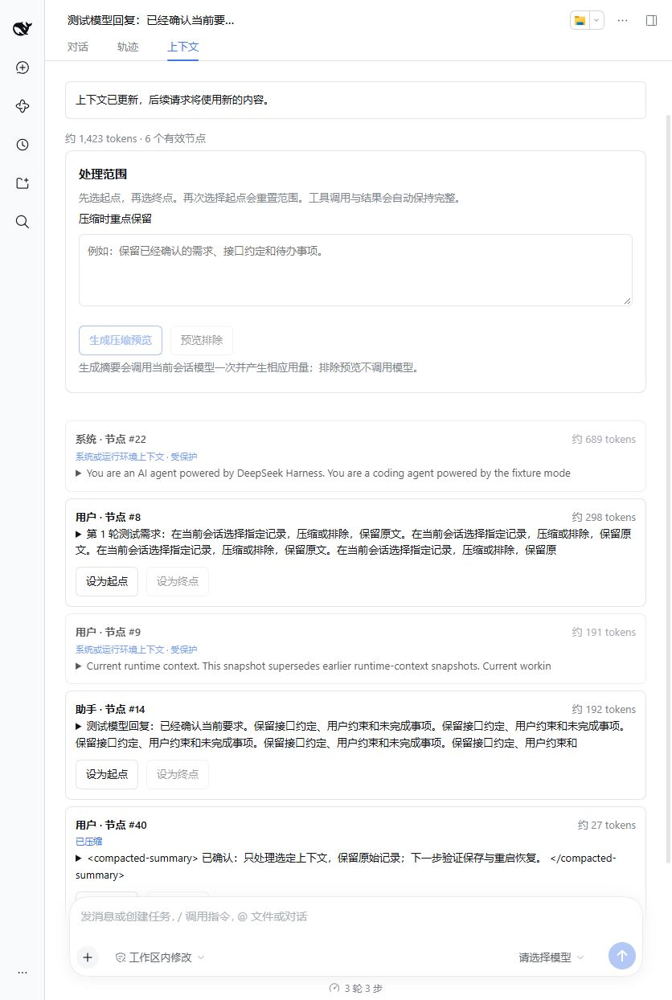
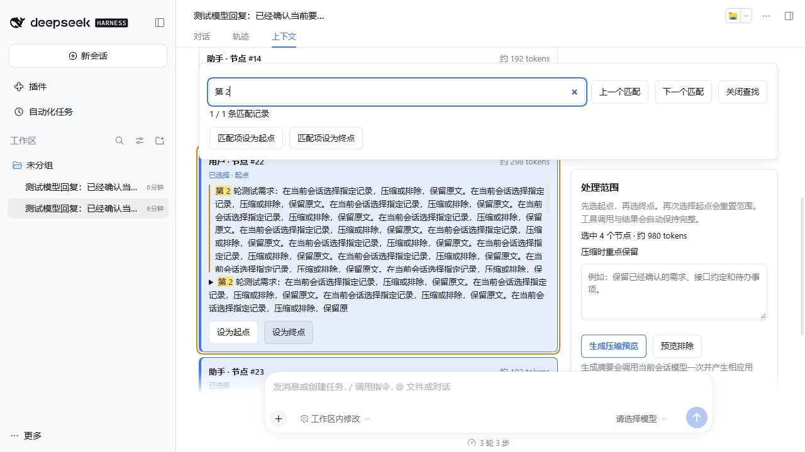
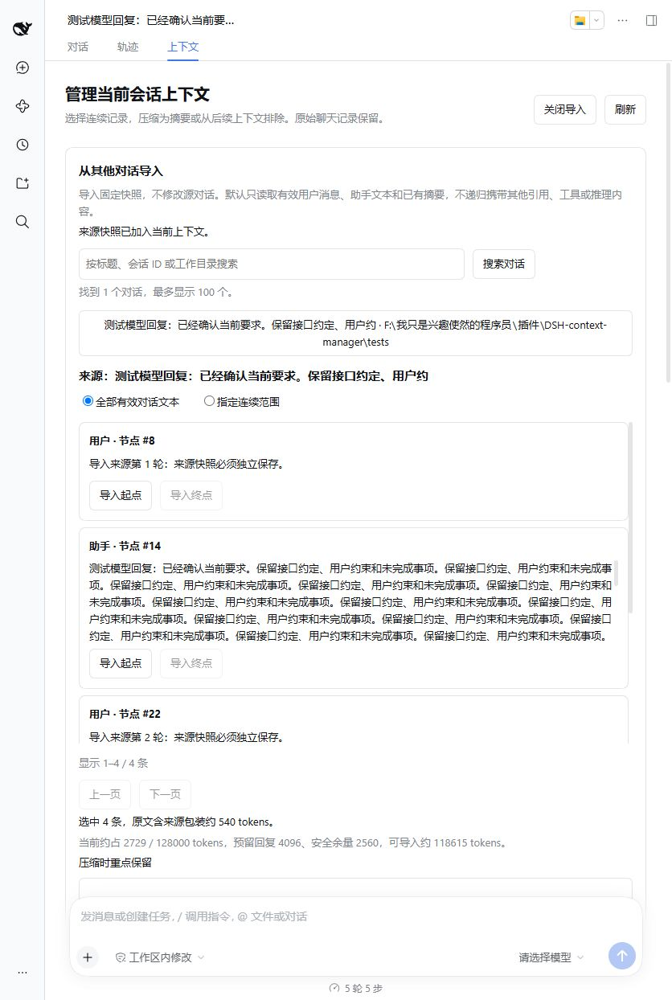

# 实现、配置与验证

DSH 上下文管理插件，第一版更新 `0.1.2`。已在 DeepSeek Harness `0.2.1-rc.2` 验证。

在会话上方的「上下文」标签页中选择连续记录，生成可编辑摘要，或将指定范围从后续模型上下文中排除。原始聊天记录保留。

支持从其他对话导入全部有效文本或连续范围。容量足够时保留原文，超出预算时可生成压缩预览；超长来源使用分块摘要与合并。确认后以固定快照保存到当前会话。



## 安装

在 DSH 插件管理器中选择包含本项目 `package.json` 的本地目录。也可以使用对应安装环境提供的 CLI：

```powershell
dsh plugin --profile web add "."
```

安装 `.tgz` 时把目录路径换成安装包路径。重启或重新加载 DSH 后，打开一个已有会话，进入「上下文」。插件未发布到 npm registry，暂时使用本地目录或安装包。

桌面版管理 `desktop` profile 时，使用桌面应用自带的插件管理器或附带 CLI，不要用独立 npm CLI 修改桌面版保留的 profile。开发测试使用独立 `DSH_HOME`，不会写入日常会话目录。

需要 Host 服务 `connection`、`sessionController`、`sessionQuery`、`sessions`、`tokenMeter`、`llm`，以及客户端会话视图插槽与 locale。没有这些服务的 headless / SDK composition 不属于本版支持范围。DSH API 仍在变化，其他版本需要另行验证。

## 使用

1. 等待当前会话结束运行，进入「上下文」，查看当前模型有效节点及 token 估算。
2. 对一条记录点击「设为起点」，再对同一条或后面的记录点击「设为终点」。顺序依据当前上下文位置，不依据节点编号大小。
3. 压缩：可填写重点保留内容，点击「生成压缩预览」。修改摘要后点击「应用摘要」。预览本身不替换上下文。
4. 排除：点击「预览排除」，核对范围后点击「应用排除」。选区原文会被一条短标记替代；不调用模型。
5. 操作成功后刷新有效上下文。原始记录仍可在普通对话或轨迹中查看。

工具调用与结果会自动扩展成完整范围，并在页面中提示。系统提示、开发者消息和自动生成的运行环境快照受到保护；包含这些节点的范围不能处理。

起点、终点及两者之间的全部记录会持续高亮；选区校验期间也会立即显示所选范围，校验通过后额外标记自动扩展的工具组。导入面板使用相同的连续范围高亮，跨页选择时保留边界。顺序始终以有效上下文位置为准，不能用日志编号大小判断先后。

### 关键词查找与手动压缩

1. 打开「上下文」，按 `Ctrl+F`（macOS 为 `Cmd+F`）或点击「查找上下文」。重复快捷键会重新聚焦并选中关键词；`Esc` 关闭查找。
2. 输入关键词，按字面、不区分大小写查找当前会话全部有效节点的完整文本，包括预览截断后的文本及较早未显示的节点；已排除的原始日志不会重新纳入。
3. 使用上/下一个匹配按钮切换匹配记录；查找框内 `Enter` 下一个、`Shift+Enter` 上一个。关键词高亮，当前匹配记录有独立边框。结果按匹配记录计数，单条记录内多个相同词算一条。
4. 点击「匹配项设为起点」，再定位另一个匹配项并点击「匹配项设为终点」。也可以使用记录上的原有起点、终点按钮。可以更换关键词定位另一个边界，原选区仍然保留。
5. 核对连续高亮范围，点击「生成压缩预览」，编辑后「应用摘要」。查找不会自动压缩，不会过滤掉范围中未命中的记录，也不调用模型。

定位到较早节点时，界面加载该位置附近的上下文窗口，并显示前后未展示的节点数；后台选区仍是完整连续范围。默认最多返回前 1000 条匹配记录，超出会显示总数并提示细化关键词。快捷键仅在插件的上下文视图可见时接管，其他页面保留原有行为。



### 从其他对话导入

1. 点击「从其他对话导入」，按标题、会话 ID 或工作目录搜索来源对话。
2. 选择「全部有效对话文本」，或通过「导入起点 / 导入终点」指定连续范围。长列表可以翻页，全部模式仍使用完整有效文本。
3. 查看完整来源包装的 token 估算与剩余容量。默认预算为模型窗口减去当前请求估算占用（包括工具 schema 与已有用量校准）、回复预留和安全余量。
4. 点击「自动生成导入预览」：装得下时保留原文，否则调用当前会话模型压缩。也可以明确选择原文或压缩模式。摘要可以编辑。
5. 点击「确认加入当前对话」。提交会重新计算容量；预览期间当前会话增长、切换模型或编辑后摘要过大，都可能要求缩短摘要或先压缩当前会话。

“全部”包含来源有效的直接用户文本、助手文本和已有摘要，不包含系统提示、运行环境、工具结果、推理内容、已排除范围或其他会话引用。暂不提供原始完整日志导入模式。导入以独立快照保存，源对话后续修改或删除不会改变已经保存的快照；源对话始终不被本插件修改。导入内容作为背景资料，不继承旧任务和执行许可。



## 行为与限制

- 生成摘要调用当前会话的模型一次，会产生相应用量。支持取消与超时；取消已经发出的请求仍可能产生提供方用量。
- 排除是替换为短标记，仍占少量 token。它不删除原始日志，也不承诺模型无法从保留的消息、文件、工具或历史搜索中再次获取类似内容。
- 暂不支持完整撤销、任意字符删除、自动同步源对话、跨会话自动检索记忆、自动重要性判断。
- 摘要预览默认 15 分钟有效，保存在插件进程内；刷新界面或插件重启后需要重新生成。已应用操作由 DSH 原生事件持久化。
- 默认最多显示最近 2000 个有效节点，界面会说明未显示的较早节点数量。单节点预览截取默认 800 字符，操作使用完整原文；过大选区需分段处理。
- 选区在预览后被自动压缩、修改或替换，应用会失败，要求刷新重选；范围外追加消息不必然使预览失效。
- 应用摘要前会重新检查 token 估算。没有缩小上下文的替换会被拒绝；数字是估算，实际计费以提供方为准。
- 持久化或提交失败可能发生在有效上下文已经改变之后。界面会锁定该预览并要求刷新，不自动重试。
- 本地测试覆盖原生持久化、重启恢复与后续实际请求。未使用付费模型，不代表真实模型摘要质量已经验证。
- 导入预算是估算，默认回复预留为至少 4096 tokens，安全余量为至少 2048 tokens 且不低于窗口的 2%。模型未提供上下文窗口时拒绝导入；没有剩余空间时不会自动删除当前上下文。
- 单次来源读取的完整文本快照默认限制为 8 MiB，超出时拒绝读取。分块压缩默认最多调用 64 次模型并共享 120 秒摘要时限；达到上限需缩小范围。预览前会说明可能产生多次调用费用。
- 辅助摘要调用的可选审计事件保存在本地日志中；其他用量统计插件不一定统计未应用或失败的预览。已应用摘要使用原生压缩用量记录。

## 配置

在插件对应 Cordis 行的 `config` 中配置。未知字段、非正整数在插件激活时拒绝。

| 字段 | 默认 | 说明 |
|---|---:|---|
| `maxSelectionBytes` | 512000 | 完整结构化选区的 JSON 字节上限 |
| `maxSummaryChars` | 20000 | 摘要文本字符上限 |
| `summaryMaxTokens` | 4096 | 摘要调用输出 token 上限，提供方可能将推理计入其中 |
| `summaryTimeoutMs` | 120000 | 摘要超时毫秒数 |
| `draftTtlMs` | 900000 | 预览有效期毫秒数 |
| `maxDrafts` | 20 | 当前插件进程内保留的预览数量上限 |
| `maxVisibleNodes` | 2000 | 页面最多显示的有效节点数 |
| `previewChars` | 800 | 每个节点的文本预览字符上限 |
| `maxImportBytes` | 8388608 | 来源完整文本投影快照的 JSON 字节上限 |
| `importOutputReserve` | 4096 | 导入时的最小回复 token 预留；会话配置更大时取更大值 |
| `importSafetyTokens` | 2048 | 导入安全余量的最小值；同时至少保留窗口的 2% |
| `maxImportCalls` | 64 | 单次分块摘要及合并的模型调用总上限 |
| `maxSearchResults` | 1000 | 关键词查找最多返回的匹配记录数；仍统计全部匹配记录总数 |

## 实现

这是独立插件，没有修改 DSH 安装包或核心源码。

- `context.js`：读取有效 surface、工具配对校验、选区快照、预览生命周期、摘要调用与原生事件提交。
- `imports.js`：只读来源查询、文本投影与分页、跨会话范围校验、请求预算、分块摘要与合并、快照写入。
- `index.js`：通过 DSH 已认证的 owner-only Fetch 路由提供接口，限制 JSON 写入和来源。Host 来源校验使用 HTTP bridge 保留的实际 Host。
- `client.js`：注册当前会话的 `conversation.view`，使用原生主题变量和中英文文案。
- `cordis.patch.yml`：将 Host 插件加入 composition；客户端通过 `dsh.client` 元数据发现。

摘要应用使用独立的 `compaction/start`、`compaction/summary`、范围替换 `user/message`、`compaction/end`，在空闲维护操作中执行并等待 `sessions.flush()`。排除使用原生 `compaction/prune` 紧邻范围替换，不伪造一次模型摘要事务。选区原事件从不重写。

预览审计是可忽略的 `plugin:context-manager/operation` 记录；有效上下文变化由原生事件决定。卸载插件后仍可读取已处理会话。预览用到的选区、系统节点引用、输入修订、用户侧重点及模型输出在审计中记录；应用后的用户编辑摘要另外保留在原生摘要事件。

导入使用原生 `user/message` + `session-reference` / `recall` 来源并追加到有效 surface，不伪造压缩替换事务。正文包含来源 ID、标题、捕获位置、选区和压缩标记。跨会话源序号保存在来源正文和审计中，不伪装为目标日志的 `sourceEventSeqs`。语义摘要的模型输出及用量保存在可忽略审计事件中。

## 开发与验证

```powershell
npm ci
npm run check
npm test
npm pack
```

测试覆盖 UI 完整操作流程、来源发现与分页、完整及部分导入、分块预算、快照独立性、容量冲突、受保护内容、工具调用配对、取消、并发维护、草稿过期、持久化失败和卸载。另有针对当前 V4 原生日志关系的验证，避免只在内存回放通过而重启失败。

`tests/runtime-fixture.js` 是仅供隔离测试的本地模型与持久化会话插件，`tests/runtime-smoke.mjs` 检查实际模型请求与原生日志，不包含在发布包中。运行它们时必须使用独立 `DSH_HOME`；不要把测试 patch 用于日常配置。

`tests/runtime-import-smoke.mjs` 在同一隔离环境中验证原文导入、部分压缩导入、来源保持不变以及下一次模型请求携带快照。重启后重复运行，验证原生日志恢复；结果记录在 `docs/runtime-import-result.json`。

构建出的插件是原生 ESM 加自包含客户端模块，无须 TypeScript 或打包工具在宿主内运行。
